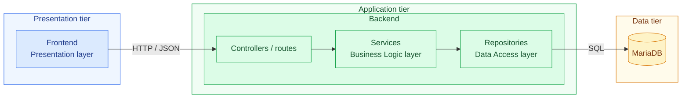

# Computer Shop Management Software

> This project was made to satisfy the final term of Software Engineering.

## Table Of Contents

- [Overview](#overview)
- [Architecture](#architecture)
- [Repository Structure](#repository-structure)
- [Prerequisites](#Prerequisites)
- [Quick Start](#quick-start)
- [Environment Variable](#environment-variables)
- [Documentation](#documentation)

## Overview

This repository is dedicated towards using Open Source Softwares to create the program,as well as document any hurdles along the way.

**Key Features**
- Storefront: live search, category filter, sorting, pinned products, shopping cart and checkout (cash on delivery or bank transfer)
- **Product detail dialog:** click a product to see its specs, stock and the shop's policies and offers (warranty, returns, delivery... as set by the admin, per category or for all products)
- Customer accounts: register, log in, edit profile, order history, cancel a `pending` order
- Admin panel (`/#/admin`): statistics, products (image upload, pin, stock), categories, **policies and offers**, orders, members
- Stock control: every product has a stock quantity; carts and orders cannot exceed it, and ordering subtracts it (cancelling returns it)
- Simple inline SVG icons instead of emoji
- Can be self-hosted by the user
- Open Source
- Frontend/Backend is containerized for ease of deployment

## Architecture

The system has three **tiers**(what runs where, each has its own container). The backend is further organized into **layers**.



| Tier | Layer(s) | Technology | Details |
|------|----------|------------|---------|
| Presentation | Presentation | React 18, Vite, nginx | [Frontend/README.md](Frontend/README.md) |
| Application | Business Logic, Data Access | Rust, axum, sqlx | [Backend/README.md](Backend/README.md) |
| Data | none (data store) | MariaDB | defined in `compose.yaml` |

## Repository Structure

```
.
├── .github/                  # CODEOWNERS
├── .woodpecker/              # CI/CD pipeline instructions (yaml files)
├── Backend/                  # API service (Rust + axum)
│   ├── src/                  #   controllers, services, repositories, models, dtos, middleware
│   ├── tests/                #   api_tests.rs, logic_tests.rs, mysql_repository_tests.rs
│   ├── Cargo.toml
│   ├── Dockerfile
│   └── README.md
├── Frontend/                 # Web UI (React + Vite)
│   ├── src/                  #   Shop, Admin, App, api.js, ui.jsx (shared UI + icons), perks.js (policy icons and filtering), styles.css and their tests
│   ├── Dockerfile
│   ├── nginx.conf
│   ├── package.json
│   └── README.md
├── Database/
│   ├── init scripts/         # init.sql: tables + seed data
├── docs/
│   ├── API.md                #   API contract between frontend and backend
│   ├── Requirements.txt      #   Team plan and requirements notes
│   └── bruno/                #   Bruno API test collection
├── .env.example              # Template for required environment variables
├── .gitignore                # Files ignored (.env) when pushed to git
├── compose.yaml              # Defines how the services run together
├── compose.override.yaml     # Override ports mapping for local deployment
├── compose.prod.yaml         # Override for adding labels for CI/CD
├── compose.test.yaml         # Services used to run all tests in Docker
├── run-tests.sh              # Runs all tests (Linux / macOS / Git Bash)
├── run-tests.ps1             # Runs all tests (Windows PowerShell)
└── README.md
```

## Prerequisites

- [Git](https://git-scm.com)
- [Docker](https://docs.docker.com/get-started/get-docker/)

## Quick Start
```bash
git clone https://github.com/Narwhal1412/Software-Engineering-Finale.git
cd Software-Engineering-Finale
cp .env.example .env # then edit with your own values
docker compose up --build
```
| Service | URL |
|---------|-----|
| Frontend | http://localhost:80 (cổng đổi bằng `WEB_PORT`) |
| Backend API | http://localhost:3000 |
| MariaDB | 127.0.0.1:3306 (chỉ máy local) |

> Backend lưu dữ liệu trong **MariaDB** (bản mock in-memory chỉ dùng cho test). Dữ liệu mẫu nạp từ `init.sql` ở lần chạy đầu tiên, mỗi sản phẩm mẫu đã có sẵn tồn kho (`stock`). Tài khoản demo (mật khẩu `123456`): `admin@pc.vn`, `khach1@pc.vn`, `khach2@pc.vn`, `khach3@pc.vn`. Xem [Backend/README.md](Backend/README.md).

Stop everything with `docker compose down`.

> **Upgrading from a version without stock control:** `init.sql` now creates `products.stock` but only runs on an empty database. Run `docker compose down -v` first (this deletes the old data), or follow the `ALTER TABLE` steps in [Backend/README.md](Backend/README.md#database-note-upgrading-an-existing-database).

## Manual Setup

Run the services directly on your machine instead of in Docker. Requires Rust (stable), Node.js 20+, and a running MariaDB. You can start only the database with Docker:

```bash
docker compose up -d db
```

**Backend** (terminal 1):

```bash
cd Backend
cp .env.example .env   # DB_HOST=localhost by default; adjust DB_* and JWT_SECRET
cargo run
```

The API listens on http://localhost:3000.

**Frontend** (terminal 2):

```bash
cd Frontend
npm ci
npm run dev
```

Open http://localhost:5173. The Vite dev server proxies `/api` and `/uploads` to `http://localhost:3000` (set `API_TARGET` to change it).

## Running Tests

All tests (backend and frontend) are run only through the test script. Docker must be running; the script starts a temporary MariaDB, runs `cargo test` and the frontend tests (Vitest), then cleans up.

```bash
./run-tests.sh      # Linux / macOS / Git Bash
```

```powershell
.\run-tests.ps1     # Windows PowerShell
```

If PowerShell blocks the script: `powershell -ExecutionPolicy Bypass -File .\run-tests.ps1`

The script ends with `TẤT CẢ TEST ĐỀU PASS` (all passed) or `CÓ TEST LỖI` (some failed) and returns a non-zero exit code on failure. The first run is slow because images and dependencies are downloaded.

## Coding Conventions

| Part | Tool | Configuration | How to run |
|------|------|---------------|------------|
| Backend (Rust) | rustfmt | default rules | `cargo fmt --check` (fix: `cargo fmt`) |
| Backend (Rust) | Clippy, every warning treated as an error | `-D warnings` | `docker compose -f compose.test.yaml run --rm backend-lint` |
| Frontend (JS/JSX) | Prettier | `Frontend/.prettierrc` | `npm run format:check` (fix: `npm run format`) |
| Frontend (JS/JSX) | ESLint | `Frontend/eslint.config.js` | `npm run lint` |
| Frontend (all files) | EditorConfig | `Frontend/.editorconfig` | editor plugin |

### Formatting

- Files are UTF-8 with LF line endings, end with a newline and have no trailing spaces (EditorConfig).
- Frontend: 2-space indentation, single quotes, semicolons, no trailing commas, arrow functions without parentheses for one parameter (`x => x`), lines up to 120 characters (Prettier).
- Backend: standard rustfmt layout (4 spaces, lines up to 100 characters).

### Naming

| Item | Rule | Example |
|------|------|---------|
| Rust files, modules, functions, variables | `snake_case` | `order_service.rs`, `place_order` |
| Rust types, traits, enum variants | `PascalCase` | `OrderStatus`, `UserRepository` |
| Rust constants | `SCREAMING_SNAKE_CASE` | `MAX_CART_QUANTITY` |
| Backend files by layer | `<feature>_<layer>.rs` | `cart_controller.rs`, `cart_service.rs`, `cart_dto.rs` |
| Repository implementations | `<feature>_<store>_repository.rs` | `product_mysql_repository.rs`, `product_mock_repository.rs` |
| React component files | `PascalCase.jsx` | `Shop.jsx`, `Admin.jsx` |
| Other frontend modules | lower-case `.js` or `.jsx` | `api.js`, `perks.js`, `ui.jsx` |
| JS functions, variables | `camelCase` | `loadCart`, `catName` |
| React components | `PascalCase` | `CartModal`, `ProductForm` |
| JSON fields in the API | `camelCase` | `categoryId`, `createdAt` |
| Tests | Rust: `*_tests.rs` or `tests/`; frontend: `*.test.js(x)` next to the file under test | `api.test.js` |

### Backend structure rules

- Keep the layers separate: controllers only read the request and call a service; business rules and validation live in services; SQL lives only in repositories (`sqlx::query`, never the `query!` macro because it needs a live database at build time).
- Admin permission is checked in the service with `require_admin`, not in the route, so it can be tested without HTTP.
- Return `Result<_, AppError>`. Do not use `unwrap()` or `expect()` outside tests; map errors to an `AppError` variant with the right HTTP status (400, 403, 404, 409...).
- Error messages shown to the user are written in Vietnamese because the frontend displays them as they are.
- Magic numbers (limits, maximum lengths) are named constants, for example in `models/limits.rs`.
- Dependency versions in `Cargo.toml` are pinned with `=` so every member builds the same result; commit `Cargo.lock`.

### Frontend structure rules

- Every HTTP call goes through `src/api.js`; components never call `fetch` directly.
- Shared UI (modal, field, icons, order box) lives in `ui.jsx`; page-level components live in `Shop.jsx` and `Admin.jsx`.
- ESLint rules: `react-hooks/rules-of-hooks` and `no-var` are errors; `react-hooks/exhaustive-deps`, `eqeqeq`, `prefer-const` and `no-unused-vars` (unused names may start with `_`) are warnings.
- Do not leave `console.log` in committed code.

### Comments and documentation

- Rust: `//!` at the top of every module to say what it does, `///` on every public function, struct and constant. Comments explain why, not what.
- Frontend: a short `//` comment above any non-obvious rule, such as the backend contract in `api.js`.

### Tests

- Every new business rule gets a service test in `Backend/src/services/service_tests.rs` or an API test in `Backend/tests/`.
- Every new screen or API function gets a Vitest test next to its source file.
- Tests must pass with `./run-tests.sh` before a change is merged.

## Environment Variables

Copy `.env.example` to `.env` and fill in the values.

```
cp .env.example .env
```
| Variable | Description | Example |
|----------|-------------|---------|
| `DB_ROOT_PASSWORD` | MariaDB root password | `change-me-root` |
| `DB_USER` | Database username | `app` |
| `DB_PASSWORD` | Database password | `change-me` |
| `DB_NAME` | Database name | `appdb` |
| `JWT_SECRET` | Token signing key, >= 16 chars (change in production) | `openssl rand -hex 32` |
| `JWT_TTL_HOURS` | Token lifetime in hours | `24` |
| `CORS_ALLOWED_ORIGINS` | Allowed origins, comma separated (`*` = all) | `*` |
| `WEB_PORT` | Host port for the web UI (local only) | `80` |
| `APP_HOST` | Domain, only for `compose.prod.yaml` | `shop.example.com` |

The backend always listens on port 3000 inside Docker (the frontend's nginx proxies to `backend:3000`).
 
## Documentation

| Document | Content |
|----------|---------|
| [Backend/README.md](Backend/README.md) | What the backend does, structure, endpoints, env vars, tests |
| [Frontend/README.md](Frontend/README.md) | What the frontend does, structure, env vars, tests |
| [docs/API.md](docs/API.md) | API contract between frontend and backend |
| [docs/bruno/](docs/bruno/) | Bruno API test collection (128 requests) and `bruno_coverage.md` |
| [Database/init scripts/init.sql](Database/init%20scripts/init.sql) | Tables + seed data, run automatically by MariaDB on first start |
