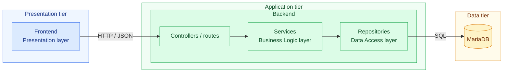

# Computer Management Web Application

> This project was made to satisfy the final term of Software Engineering.

## Table Of Contents

- [Overview](#overview)
- [Architecture](#architecture)
- [Repository Structure](#repository-structure)
- [Prerequisites](#Prerequisites)
- [Quick Start](#quick-start)
- [Environment Variable](#environment-variables)
- [Documentation](#documentation)

## Overview

This repository is dedicated towards using Open Source Softwares to create the program,as well as document any hurdles along the way.

**Key Features**
- Can be self-hosted by the user
- Open Source
- Frontend/Backend is containerized for ease of deployment

## Architecture

The system has three **tiers**(what runs where, each has its own container). The backend is further organized into **layers**.



| Tier | Layer(s) | Technology | Details |
|------|----------|------------|---------|
| Presentation | Presentation | ... | [Frontend/README.md](Frontend/README.md) |
| Application | Business Logic, Data Access | ... | [Backend/README.md](Backend/README.md) |
| Data | none (data store) | MariaDB | defined in `compose.yaml` |

## Repository Structure

```
.
├── Backend/          	  # API service
├── Frontend/         	  # Web UI
├── Database/             # Database sqls
├── .woodpecker 	  # CI/CD Pipeline instructions yaml files
├── docs/             	  # Plans, notes, design decisions
├── .env.example      	  # Template for required environment variables
├── compose.yaml      	  # Defines how the services run together
├── compose.override.yaml # Override ports mapping for local deployment
├── compose.prod.yaml 	  # Override for adding labels for CI/CD
├── .gitignore 		  # Files ignored(.env) when pushed to git 
└── README.md
```

## Prerequisites

- [Git](https://git-scm.com)
- [Docker](https://docs.docker.com/get-started/get-docker/)

## Quick Start
```bash
git clone https://github.com/Narwhal1412/Software-Engineering-Finale.git
cd Software-Engineering-Finale
cp .env.example .env # then edit with your own values
docker compose up --build
```
| Service | URL |
|---------|-----|
| Frontend | http://localhost (cổng đổi bằng `WEB_PORT`) |
| Backend API | http://localhost:3000 |
| MariaDB | 127.0.0.1:3306 (chỉ máy local) |

> Hiện backend chạy bằng **database giả (mock in-memory)**; MariaDB chạy cạnh để kiểm tra `init.sql`. Tài khoản demo (mật khẩu `123456`): `admin@pc.vn`, `khach1@pc.vn`, `khach2@pc.vn`, `khach3@pc.vn`. Xem [Backend/README.md](Backend/README.md).

Stop everything with `docker compose down`.

## Environment Variables

Copy `.env.example` to `.env` and fill in the values.

```
cp .env.example .env
```
| Variable | Description | Example |
|----------|-------------|---------|
| `DB_ROOT_PASSWORD` | MariaDB root password | `change-me-root` |
| `DB_USER` | Database username | `app` |
| `DB_PASSWORD` | Database password | `change-me` |
| `DB_NAME` | Database name | `appdb` |
| `JWT_SECRET` | Token signing key, >= 16 chars (change in production) | `openssl rand -hex 32` |
| `JWT_TTL_HOURS` | Token lifetime in hours | `24` |
| `CORS_ALLOWED_ORIGINS` | Allowed origins, comma separated (`*` = all) | `*` |
| `WEB_PORT` | Host port for the web UI (local only) | `80` |
| `APP_HOST` | Domain, only for `compose.prod.yaml` | `shop.example.com` |

The backend always listens on port 3000 inside Docker (the frontend's nginx proxies to `backend:3000`).
 
## Documentation

| Document | Content |
|----------|---------|
| [Backend/README.md](Backend/README.md) | Backend structure (every folder/file), mock accounts, endpoints, env vars, tests |
| [docs/API.md](docs/API.md) | API contract between frontend and backend |
| [docs/DATABASE_SPEC.md](docs/DATABASE_SPEC.md) | Database spec and **how to replace the mock with the real MariaDB (section 7)** |
| [docs/BACKEND_ASSUMPTIONS.md](docs/BACKEND_ASSUMPTIONS.md) | Decisions the API contract does not specify |
| [docs/bruno/](docs/bruno/) | Bruno API test collection (128 requests) and `bruno_coverage.md` |
| [Database/init scripts/init.sql](Database/init%20scripts/init.sql) | Tables + seed data, run automatically by MariaDB on first start |
